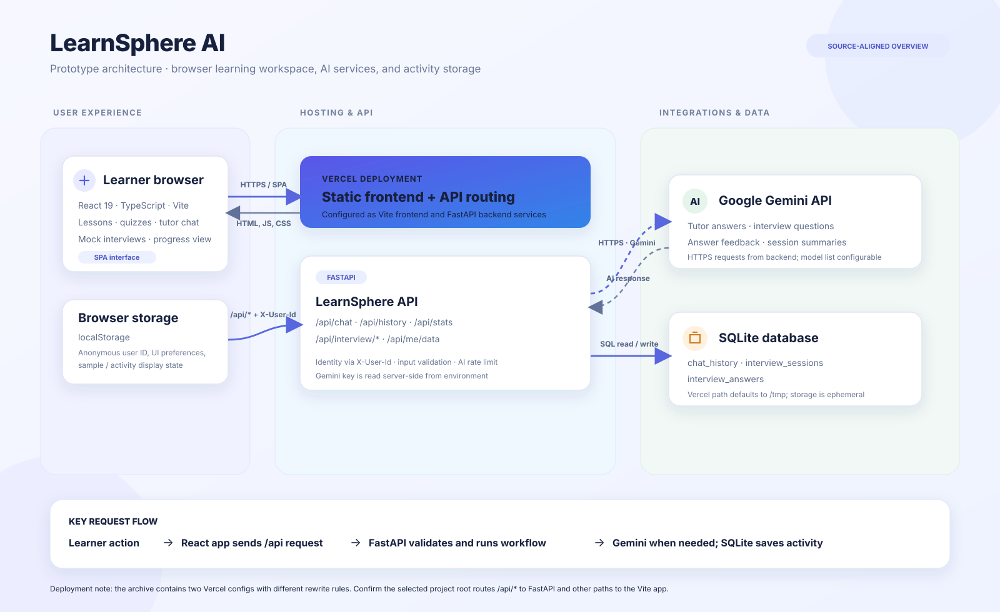
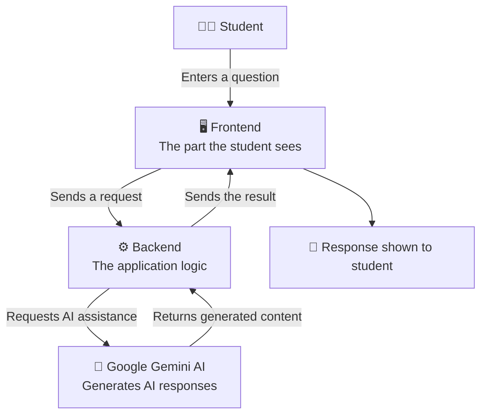
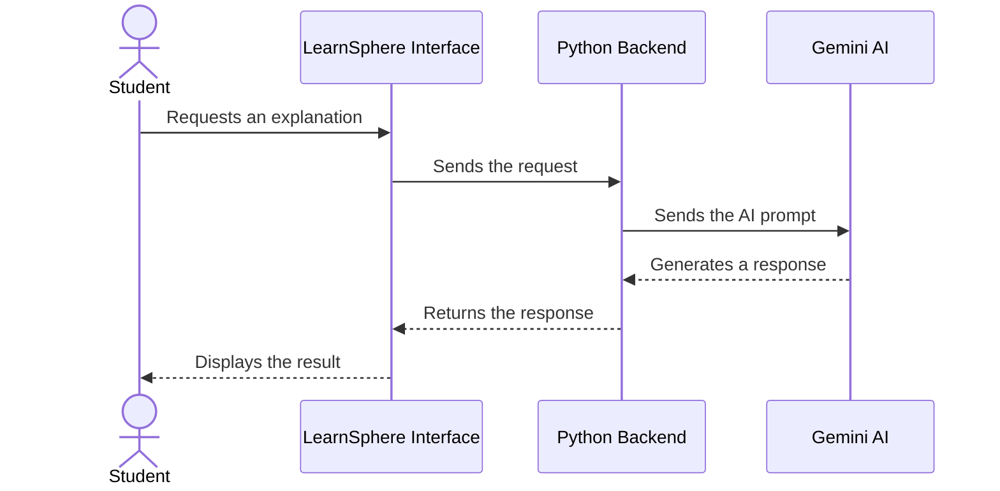
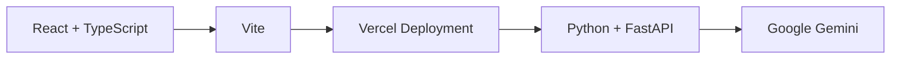
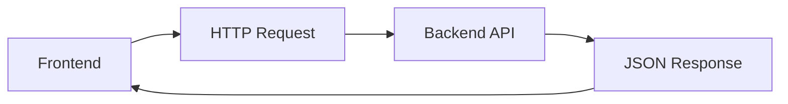
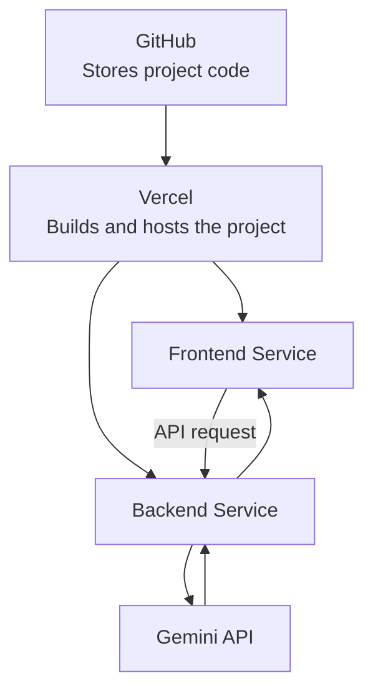

# 🌍 LearnSphere AI
### Learn Smarter. Understand Better. Grow Further.

**An AI-powered learning assistant designed to make learning simpler, more interactive, and accessible.**

---

## 1. 💡 What Is LearnSphere AI?

LearnSphere AI is a prototype of an AI-powered learning platform that aims to help students learn and understand concepts more easily with the assistance of Artificial Intelligence.

Traditional learning often depends on textbooks, fixed explanations, and searching through multiple websites. Students may struggle when a topic is difficult to understand or when they need an explanation suited to their level.

LearnSphere AI explores how generative AI can make this process more interactive.

Instead of treating learning as a one-way process, the idea is to let students interact with an AI-powered system and receive responses to their learning requests.

**In simple words:** LearnSphere AI is like a digital learning assistant that can help explain concepts through an AI-powered interface.

> **Important:** LearnSphere AI is a prototype. Its actual capabilities depend on the features implemented and connected in the current version.

---

## 2. 🎯 The Problem We Want to Solve

Students can face several common learning challenges:

- **Complex concepts:** Some topics are difficult to understand from a textbook alone.
- **Information overload:** Searching multiple websites can take time.
- **Limited interaction:** Static learning resources may not answer a student's specific question.
- **Different learning needs:** Students may need an alternative explanation of the same topic.

### Our approach

LearnSphere AI explores an interactive, AI-assisted way of learning.

| Traditional learning challenge | LearnSphere AI approach |
|---|---|
| A concept is difficult to understand | Ask for an AI-generated explanation |
| Searching takes time | Request information through one learning interface |
| One explanation may not be enough | Ask follow-up questions where supported |
| Learning tools may feel disconnected | Bring supported learning interactions into one platform |

The aim is not to replace teachers. It is to explore how AI can support students, teachers, and self-learners.

---

## 3. 🚀 Our Proposed Solution

LearnSphere AI combines three main elements:

1. **A user-friendly interface** where students interact with the application.
2. **A backend system** that receives requests and manages application logic.
3. **Generative AI** that can produce responses to supported learning requests.

The overall idea is simple:

**Student asks → Application processes → AI generates a response → Student learns from the result.**

---

## 4. 🏗️ System Architecture — The Big Picture

You do not need to know every programming detail to understand this architecture.

Think of LearnSphere AI as a team of three components, each with a different responsibility.

## Architecture location




## Sample data

- [Lesson and quiz dataset](LearnSphere/data/sample/learnsphere-sample-dataset.json)
- [House-prices CSV](LearnSphere/data/sample/sample-house-prices.csv)
- [Sample SQLite database](LearnSphere/data/sample/learnsphere-sample.db)
- [Sample data notes](LearnSphere/data/sample/README-sample-data.md)
  
### Understand each component

**1. Frontend — The face of the application**

The frontend is the part that users see and interact with: pages, buttons, input fields, layouts, and displayed results.

It is built using React, TypeScript, and Vite.

**2. Backend — The brain of the application logic**

The backend receives requests from the frontend, performs the necessary processing, communicates with AI services when required, and sends responses back.

The backend is built using Python and FastAPI.

**3. Google Gemini — The generative AI engine**

Gemini is the AI service connected to the backend. It can generate responses based on the request and the model's capabilities.

The backend acts as the intermediary between the frontend and Gemini.

**Why separate them?**

Separating the interface, application logic, and AI integration makes the project easier to maintain, test, and improve.

---

## 5. 🔄 How Does LearnSphere AI Work?

Imagine a student wants to understand the concept of machine learning.



### Step-by-step explanation

1. The student interacts with LearnSphere AI.
2. The frontend collects the student's input.
3. The frontend sends a request to the backend.
4. The backend processes the request and calls Gemini when the feature requires it.
5. Gemini generates a response.
6. The backend returns the response to the frontend.
7. The student sees the result in the application.

This is a typical AI request flow. Not every action in the application necessarily requires a Gemini API call.

---

## 6. 🧰 Technology Stack — Explained in Simple English

A technology stack is simply the collection of tools used to build and run an application.

You can explain our main technologies like this:

| Technology | Simple meaning | Why it is used |
|---|---|---|
| React | A tool for building user interfaces | Creates interactive screens and reusable components |
| TypeScript | JavaScript with additional type checking | Helps developers catch certain coding mistakes |
| Vite | A frontend development and build tool | Helps run and package the frontend |
| Python | A programming language | Implements backend application logic |
| FastAPI | A Python framework for APIs | Receives requests and sends structured responses |
| Google Gemini | A generative AI service | Generates responses to supported prompts |
| Vercel | A cloud deployment platform | Publishes the application and routes requests |
| GitHub | A code hosting and collaboration platform | Stores the source code and tracks changes |

### How these technologies work together



This diagram shows the main roles, not every build-time or runtime dependency.

---

## 7. 🌐 How Does the Frontend Communicate With the Backend?

The frontend and backend are separate parts of the application, so they need a way to exchange information.

They communicate through an **API**.

An API is a set of rules that allows two software components to communicate.

For example, the frontend might send a request to an endpoint such as `/api/...`. The backend receives that request and returns a response, often in JSON format.



In the deployed prototype, Vercel routes API requests to the backend service and other application requests to the frontend service, according to the deployment configuration.

**Why is this useful?** The user interface does not need to contain the AI provider's secret API key. The backend can keep that key in server-side configuration.

---

## 8. ☁️ How Is LearnSphere AI Deployed?

Deployment means making an application available beyond a developer's own computer.

LearnSphere AI is configured for a frontend service and a backend service on Vercel.



### Deployment in simple words

- **GitHub** stores the project's source code.
- **Vercel** builds and hosts the configured services.
- **Frontend service** delivers the user interface.
- **Backend service** processes API requests.
- **Gemini API** provides AI-generated responses when requested.

This setup separates the public-facing interface from server-side processing.

---

## 9. 🔐 How Do We Protect the AI API Key?

AI providers commonly require an API key to authorize requests.

LearnSphere AI should keep its Gemini API key on the backend, stored as an environment variable.

An environment variable is a configuration value supplied to the application at runtime rather than written directly into source code.

```text
Student
   │
   ▼
Frontend
   │
   ▼
Backend ───────► Gemini API
   │                 ▲
   └── Uses a securely configured API key
```

The key should not be placed in public frontend code or committed to GitHub.

This reduces the risk of exposing credentials, although proper access controls, request validation, and usage limits are also important.

---

## 10. 🌱 What Makes This Project Valuable?

LearnSphere AI explores several useful ideas:

- **Interactive learning:** Students can engage with an AI-powered interface.
- **Accessible explanations:** Generative AI can provide alternative ways of explaining a topic.
- **Modular architecture:** Frontend and backend responsibilities are separated.
- **AI integration:** The project connects a real application backend to a generative AI service.
- **Room to grow:** The architecture can be extended with additional learning features.

The project demonstrates how an AI service can be integrated into a web application rather than being used only through a standalone chat interface.

---

## 11. 🔭 Future Scope

The following are possible future enhancements, not claims that they are all currently implemented:

- Personalized learning paths based on student goals.
- Quizzes and practice questions with feedback.
- Learning progress tracking.
- Summaries of study materials.
- Support for uploaded learning documents.
- Additional AI providers and model fallback.
- Accessibility improvements and multilingual explanations.
- More comprehensive evaluation of AI response quality.

These features could be prioritized according to user feedback and project requirements.

---

## 12. ⚖️ Limitations and Responsible AI

Generative AI can produce incorrect, incomplete, or misleading information. Therefore:

- Students should verify important information.
- AI-generated answers should not be treated as guaranteed facts.
- API availability and usage limits can affect the experience.
- Personal information should not be entered unnecessarily.
- Educational use should encourage understanding rather than simply copying answers.

LearnSphere AI should be viewed as a learning aid, not a replacement for teachers, textbooks, or independent thinking.

---

## 13. 🧑‍⚖️ How to Explain This Project to Judges

Here is a short explanation you can practice before your presentation.

> "LearnSphere AI is our prototype for an AI-powered learning platform. The problem we are exploring is that students sometimes struggle to understand complex topics and need a more interactive way to learn.
>
> Our application combines a frontend built with React and TypeScript, a Python backend using FastAPI, and Google's Gemini AI for supported AI-powered tasks.
>
> When a student makes a request, the frontend sends it to our backend. The backend processes the request and communicates with Gemini when needed. The generated response is then returned to the frontend and presented to the student.
>
> We have separated the frontend and backend so that the application is easier to maintain and extend. The prototype is configured for deployment on Vercel, and the Gemini API key is intended to remain on the server side.
>
> Our goal is to explore how generative AI can make learning more interactive, with future opportunities for personalization, practice, and progress tracking."

**Presentation tip:** Demonstrate an actual working feature while explaining the flow. Only claim functionality you can show working in the current prototype.

---

## 14. ❓ Questions Ask

**Q1. What problem does LearnSphere AI address?**

It explores how an AI-powered interface can help students get interactive explanations and support for learning requests.

**Q2. Why did you use AI?**

Generative AI can produce contextual responses to user prompts, making it suitable for exploring interactive learning experiences.

**Q3. Why React for the frontend?**

React supports reusable interface components, which helps organize and maintain interactive web applications.

**Q4. Why FastAPI for the backend?**

FastAPI is a Python framework for creating APIs. It lets the application receive requests, process data, and return structured responses.

**Q5. What is the role of Gemini?**

Gemini is the generative AI service. The backend sends supported prompts to it and receives generated content.

**Q6. Why not call Gemini directly from the frontend?**

Keeping the API key on the backend avoids exposing the secret in browser code and gives the application a central place to validate and manage requests.

**Q7. What happens if Gemini is unavailable?**

The request may fail or time out. Appropriate error handling and fallback mechanisms can improve reliability, but they should only be claimed as implemented after testing them.

**Q8. What is the difference between frontend and backend?**

The frontend is what the user sees and interacts with. The backend handles server-side logic, API requests, and communication with external services.

**Q9. Is LearnSphere AI a finished product?**

It is a prototype intended to demonstrate an AI-assisted learning concept. Its current capabilities should be judged by the features actually implemented and demonstrated.

**Q10. What would you improve next?**

I would prioritize reliable AI responses, better error handling, learning personalization, quizzes, progress tracking, and evaluation of educational accuracy.

---

## 15. 🏁 Conclusion

LearnSphere AI demonstrates a practical way to connect a modern web interface, a backend API, and a generative AI service.

Its central idea is simple: make AI-assisted learning more accessible through a familiar web application, while keeping the system modular enough to improve over time.

**LearnSphere AI — Making learning more interactive, one concept at a time.**

---

### Project Information

- **Project:** LearnSphere AI
- **Category:** AI / EdTech prototype
- **Frontend:** React, TypeScript, Vite
- **Backend:** Python, FastAPI
- **AI Service:** Google Gemini
- **Deployment:** Vercel Services
- **Source Code:** [Add your GitHub repository URL]
